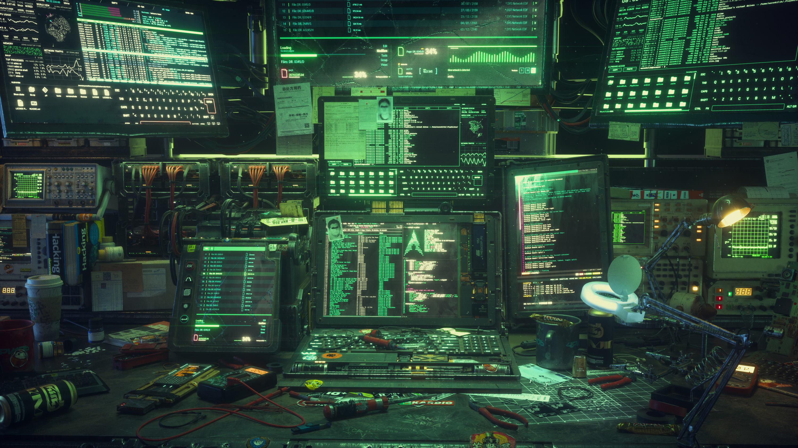
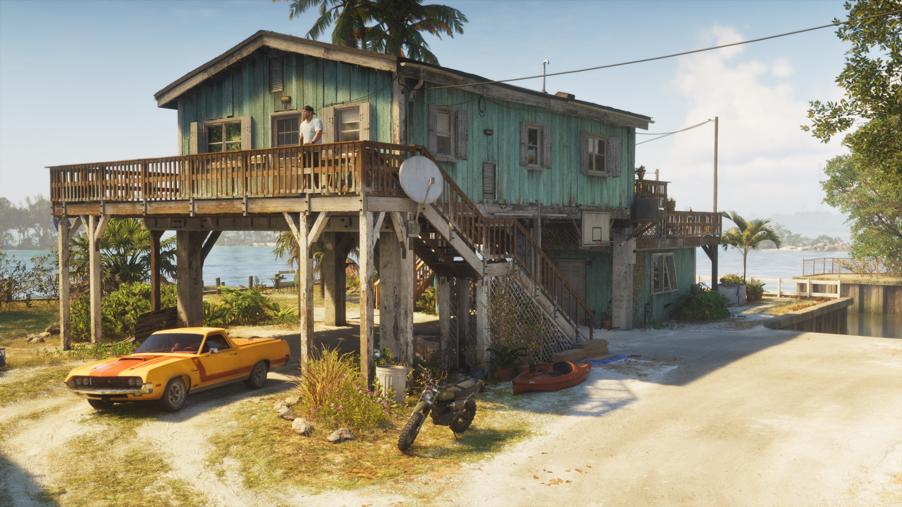

# Hyprland-dotfiles

# Hyprland Dotfiles

My personal **Hyprland configuration** for a clean, minimal, and productive Linux desktop.

Built around a Wayland workflow with a focus on simplicity, performance, and customization.

## Components

- **Hyprland** – Dynamic tiling Wayland compositor
- **Waybar** – Custom status bar
- **Ghostty** – GPU-accelerated terminal
- **Mako** – Notification daemon
- **Hyprpaper** – Wallpaper management

## Requirements

- Arch Linux / CachyOS
- Hyprland
- Waybar
- Ghostty
- Mako
- Hyprpaper

## Installation

Clone the repository:

```bash
git clone https://github.com/RazorCoding/Hyprland-dotfiles.git
cd Hyprland-dotfiles
```

Review the configuration files before applying them to your system.

## Wallpapers

A curated collection of wallpapers included in the [`Wallpapers/`](Wallpapers) directory.

| | | |
|:---:|:---:|:---:|
| <br>`wallhaven-3qqqkv.jpg` | <br>`wallhaven-jeeq3q.png` | <br>`wallhaven-jel1jq.jpg` |
| <br>`wallhaven-lygqdp.jpg` | <br>`wallhaven-o5z9jl.jpg` | <br>`wallhaven-rq31v1.jpg` |
| <br>`wallhaven-yqkl97.jpg` | <br>`wallhaven-zpoxyj.png` | |

## Note

These are my personal dotfiles. Feel free to explore, customize, and adapt them to your own workflow.


