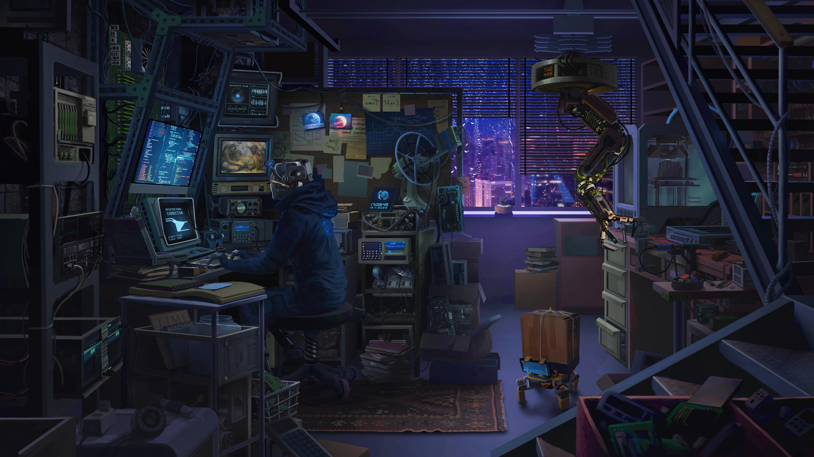

# Hyprland-dotfiles

Clone the repository:

```bash
git clone https://github.com/RazorCoding/Hyprland-dotfiles.git
cd Hyprland-dotfiles
```
## Pictures

| | | |
|:---:|:---:|:---:|
| <br>`wallhaven-3qqqkv.jpg` | <br>`wallhaven-jeeq3q.png` | <br>`wallhaven-jel1jq.jpg` |
| <br>`wallhaven-lygqdp.jpg` | <br>`wallhaven-o5z9jl.jpg` | <br>`wallhaven-rq31v1.jpg` |
| <br>`wallhaven-yqkl97.jpg` | <br>`wallhaven-zpoxyj.png` | |


